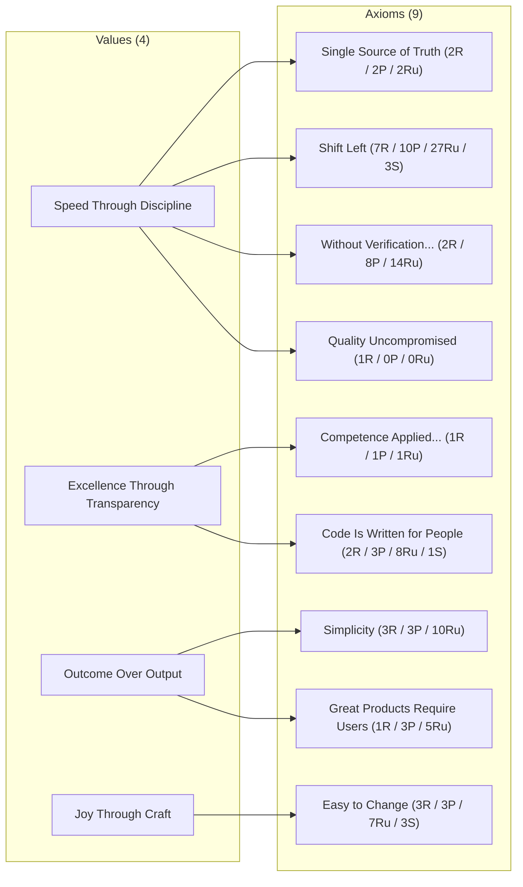

# Governance Rule Tree Audit: `uql` Consistency & Human Ergonomics

## Executive Summary

Auditing the 6-level governance tree ([CodingPyramid.yaml](file:///Users/Shared/workspace/agents2/rules/CodingPyramid.yaml), [Values.yaml](file:///Users/Shared/workspace/agents2/rules/Values.yaml), [Axioms.yaml](file:///Users/Shared/workspace/agents2/rules/Axioms.yaml), [Rationales.yaml](file:///Users/Shared/workspace/agents2/rules/Rationales.yaml), [Principles.yaml](file:///Users/Shared/workspace/agents2/rules/Principles.yaml), [Rules.yaml](file:///Users/Shared/workspace/agents2/rules/Rules.yaml), and [Standards.yaml](file:///Users/Shared/workspace/agents2/rules/Standards.yaml)) against [RFC 0001: Ubiquitous Language (`uql`)](file:///Users/Shared/workspace/agents2/docs/rfcs/0001-ubiquitous-language.md) reveals three systemic architectural issues:

1. **Axiom Overlap & Value Skew (`UQL005` & Domain Fit)**: Among the 9 `Axiom`s, `Quality Uncompromised` is a meta-ordering rule rather than an independent domain axiom (`0` `Principle`s beneath it), while `Shift Left` (`7` `Rationale`s, `10` `Principle`s, `27` `Rule`s) conflates **temporal earliness** with **spatial boundary isolation** and **runtime observability**. Meanwhile, `Simplicity`, `Easy to Change`, and `Code Is Written for People` blur across their `body` and child `Rationale`s because their boundaries (essential scope/mechanism count vs. change locality/decoupling vs. human cognitive comprehension) are not partitioned into orthogonal `uql` predicates.
2. **Shadow Tiers (`solutions:` and `smells:`) & Level Bloat**: While humans strongly benefit from the distinction between **`Principle`s** (memorable generative stances used while authoring) and **`Rule`s** (falsifiable diff-level invariants used during review), the tree surrounds them with redundant prose layers and unindexed shadow tiers. Specifically, `Rationales.yaml` embeds **43 `solutions:`** (and `Principles.yaml` embeds 1 `solutions:`) that are actually unpromoted `Principle`s, `Rule`s, or `Standard`s, while `Rules.yaml` embeds **37 `smells:`** across 21 rules that duplicate or hold the actual falsifiable `Standard` thresholds (e.g., line/parameter counts).
3. **Broken Subsumption Chains (`parent` Mismatches & Orphans)**: In `uql`, a child node in a deductive hierarchy must **narrow the state space of its parent's domain** (`∀x : Child(x) ⇒ Parent(x)`). Across the 145 nodes in the tree, multiple children narrow a *different* `Axiom`, `Rationale`, or `Principle` than their declared `parent`, and several branches terminate prematurely (`1` `Rationale` with `0` `Principle`s, `1` `Principle` with `0` `Rule`s, and `71` of `77` `Rule`s with `0` `Standard`s).

---

## 1. Axiom Audit (Completeness, Independence & Fit)

### 1.1 Inventory of the 9 Current Axioms

| `#` | `Axiom.id` | Declared `parent` (`Value`) | Current `body` ([Axioms.yaml](file:///Users/Shared/workspace/agents2/rules/Axioms.yaml)) | Fan-out (`R` / `P` / `Ru` / `S`) |
|---|---|---|---|---|
| 1 | `Single Source of Truth` | `Speed Through Discipline` | *"Every piece of information is defined exactly once."* | 2 / 2 / 2 / 0 |
| 2 | `Shift Left` | `Speed Through Discipline` | *"Every activity occurs at the earliest point where it is possible."* | 7 / 10 / 27 / 3 |
| 3 | `Simplicity` | `Outcome Over Output` | *"Simple solutions take precedence over complex solutions."* | 3 / 3 / 10 / 0 |
| 4 | `Easy to Change` | `Joy Through Craft` | *"Software remains easy to maintain and extend."* | 3 / 3 / 7 / 3 |
| 5 | `Great Products Require Users` | `Outcome Over Output` | *"Code proves execution, and users prove correctness."* | 1 / 3 / 5 / 0 |
| 6 | `Without Verification It Is Worthless` | `Speed Through Discipline` | *"Without verification, an artifact is worthless."* | 2 / 8 / 14 / 0 |
| 7 | `Competence Applied Is Leverage` | `Excellence Through Transparency` | *"A tool multiplies applied competence, but it supplies no competence of its own."* | 1 / 1 / 1 / 0 |
| 8 | `Quality Uncompromised` | `Speed Through Discipline` | *"Quality is the highest priority."* | 1 / 0 / 0 / 0 |
| 9 | `Code Is Written for People` | `Excellence Through Transparency` | *"Code is written for people to read and understand."* | 2 / 3 / 8 / 1 |

*(Note: `Fan-out` lists counts of child `Rationale`s / `Principle`s / `Rule`s / `Standard`s).*

### 1.2 Independence Test (`UQL005` & `UQL006`)

Under [RFC 0001 §4 Invariant 3](file:///Users/Shared/workspace/agents2/docs/rfcs/0001-ubiquitous-language.md#L138), an axiomatic system `S` satisfies independence and minimality iff no axiom is entailed by the others (`∀s ∈ S : (S \ {s}) ∪ D ⊭ s`) and no constituent is non-narrowing (`UQL006`). Testing the 9 `Axiom`s reveals four independence and well-formedness failures:

#### Cluster A: `Simplicity` vs. `Easy to Change` vs. `Code Is Written for People`
- **Current Overlap**:
  - `Simplicity`: *"Simple solutions take precedence over complex solutions."* (Tautological antonym contrast emitting `UQL006` unless `Simple` is defined in `D` as minimal components/state space).
  - `Easy to Change`: *"Software remains easy to maintain and extend."* (Vague dispositional predicate *"easy"*).
  - `Code Is Written for People`: *"Code is written for people to read and understand."*
  - Because unstructured prose treats *"simple"*, *"easy to maintain"*, and *"easy to read"* as synonyms, downstream nodes cross-contaminate:
    - `Less is more` (*"An implementation retains only what directly serves its stated intent and removes everything else"*) is placed under `Clarity over cleverness` (`Code Is Written for People`), yet it is identical in domain state space to `You aren't gonna need it` (`Great Products Require Users`) and `Code is a liability, not an asset` (`Simplicity`).
    - `On point prose` (under `Code Is Written for People` -> `Clarity over cleverness` -> `Less is more`) explicitly states *"Every prose representation stays on point and adheres to single source of truth"* — directly duplicating `Single Source of Truth` (`UQL005`).
- **How `uql` Restores Orthogonality**: Partition the three axioms into disjoint formal domains (`Subject` + `Predicate`):
  1. **State & Mechanism Minimality (`Simplicity`)**: Governs **cardinality of mechanisms, dependencies, and execution paths** (*"An implementation minimizes dependencies, state combinations, and execution paths."*).
  2. **Change Locality / Decoupling (`Easy to Change`)**: Governs **blast radius of a modification across boundaries** (*"A modification to one domain concern changes only the module that owns that concern."*).
  3. **Cognitive Readability (`Code Is Written for People`)**: Governs **human comprehension and lexical/structural conventions** (*"Every artifact expresses domain intent within human working-memory bounds."*).

#### Cluster B: `Shift Left` vs. `Without Verification It Is Worthless`
- **Current Overlap**:
  - `Without Verification It Is Worthless` states that an unverified artifact has zero value (existence and behavioral truth of `Verification`).
  - `Shift Left` states that every activity happens at the earliest possible stage (temporal ordering of `Verification` and `Design` stages: `Type System` < `Linter` < `Unit Test` < `Integration Test` < `Runtime`).
  - These two concepts are **logically independent** (one requires *that* verification proves behavior; the other requires *when/where* verification occurs), **but their children are entangled**:
    - `The Practical Test Pyramid` (`Shift Left`) states *"Automated test suites maintain many fast unit tests..."*, while `No gray tests` and `F.I.R.S.T.` live under `Tests prove behavior, not execution` (`Without Verification It Is Worthless`).
    - Even worse, `Shift Left` is used as a catch-all for things that are **not** about moving an activity earlier in the lifecycle: `Telemetry over guesswork` (runtime production monitoring — which is "Shift Right" / runtime observability!) and `Translate at the door` / `Encapsulation` (spatial boundary isolation / domain modeling).

#### Cluster C: `Simplicity` vs. `Great Products Require Users`
- **Current Overlap**:
  - `Great Products Require Users` (*"Code proves execution, and users prove correctness"*) has one child `Rationale`: `Validated user need over speculative scope`, which parents `You aren't gonna need it` (`YAGNI`), `Do One Thing`, and `Principle of Least Astonishment`.
  - Meanwhile, `Code is a liability, not an asset` under `Simplicity` states *"Every line of code incurs ongoing maintenance cost and delivers value only by satisfying a user need."* That second sentence is verbatim `Validated user need over speculative scope` (`UQL005` redundancy across branches).
- **How `uql` Restores Orthogonality**:
  - `Great Products Require Users` governs **external validation and user-observable behavior** (traceability to a validated user need, `Principle of Least Astonishment`, and runtime outcome verification).
  - `Simplicity` governs **internal solution economy** (reusing existing layers before adding new dependencies, eliminating optionality/boolean flags, avoiding N+1 network loops).

#### Cluster D: `Quality Uncompromised` Is a Meta-Rule, Not an Orthogonal Domain Axiom
- **Current Overlap**:
  - `Quality Uncompromised` (*"Quality is the highest priority"*) and its single child `Rationale` (`What wins when values collide`: *"Every software quality axis takes precedence over competing goods during architectural conflict"*) have **0 `Principle`s, 0 `Rule`s, and 0 `Standard`s**.
  - In `uql` (`SMT-LIB` lowering), *"Quality is the highest priority"* does not constrain a distinct domain artifact state space; instead, it defines a **lexicographic priority ordering** (hard invariants vs. soft non-functional throughput/feature desires) over all other axioms.
  - Furthermore, it shares the same parent `Value` (`Speed Through Discipline`) as `Shift Left`, `Single Source of Truth`, and `Without Verification It Is Worthless`, creating a 4-to-1 Value imbalance.

### 1.3 Missing or Misplaced Axiom Domains (`Rationales` Forced Under Ill-Fitting `Axioms`)

| Misplaced `Rationale` | Current `Axiom` | Why It Does Not Narrow Its Parent (`parent` Mismatch) | Proper `Axiom` Placement |
|---|---|---|---|
| `Telemetry over guesswork` (`Own the Runtime`) | `Shift Left` | Production telemetry, golden signals (latency, traffic, errors, saturation), and paging alerts happen in **production runtime** after deployment — the exact opposite of shifting left before runtime. | Move under `Without Verification It Is Worthless` (broadened to continuous runtime & test verification) or `Great Products Require Users` (production runtime proves user-facing health). |
| `Translate at the door`, `Encapsulation`, `Agree at the boundary` | `Shift Left` | While compile-time types (`Make illegal states unrepresentable`) do shift defect detection left to compile time, `Hexagonal Architecture` adapters (`Fold at Perimeter`), `Design by Contract`, and `Encapsulation` are fundamentally about **boundary isolation and decoupling** (`Easy to Change`) or **single contract authority** (`Single Source of Truth`). | Move `Agree at the boundary` (`Contract First`) to `Single Source of Truth`; move `Translate at the door` (ports/adapters isolation) to `Easy to Change`; keep compile-time type validation (`Parse, don't validate`, `Encapsulation`) under `Shift Left` (or a dedicated boundary/type axiom). |
| `Premature optimization and Jackson's rules` (`Make it work, make it right, make it fast`) | `Code Is Written for People` | Only the second step (*"make it right"*) relates to readability. Step 1 (*"working behavior in small slices first"*, `Keep pull requests small`, `Make it work first`) is incremental delivery, and Step 3 (*"optimizes only measured bottlenecks last"*, `No performance motivations on in-memory operations`) is empirical evidence (`Simplicity` / `Without Verification It Is Worthless`). | Split incremental slice delivery under `Great Products Require Users` (`Do One Thing`) and empirical bottleneck optimization under `Simplicity` (`Amdahl's Law and the I/O-bound reality`). |
| `Amdahl's Law and the I/O-bound reality` | `Simplicity` | Batching network requests (`Iterations over calls over the network is bad design`) often adds batching complexity in memory to optimize I/O latency. It is an empirical performance law, not a simplicity axiom. | Combine with `Premature optimization and Jackson's rules` under `Simplicity` defined as **Architectural Economy & Empirical Optimization** (eliminating wasteful work, whether lines of code or network round-trips). |

---

## 2. Levels & Naming Audit (Preserving `Principles` and `Rules` for Humans)

### 2.1 Evaluating the 6 Levels Through `uql` Domain Narrowing and Human Ergonomics

In [CodingPyramid.yaml](file:///Users/Shared/workspace/agents2/rules/CodingPyramid.yaml), the 6 levels are defined as:
`Value` -> `Axiom` -> `Rationale` -> `Principle` -> `Rule` -> `Standard`.

When we evaluate how humans and agents actually use this hierarchy alongside `uql`:

| Level | Current Role in YAML | Cognitive / `uql` Function | Ergonomic Diagnosis |
|---|---|---|---|
| **1. `Value`** (`4`) | Cultural aspiration (`Speed Through Discipline`, etc.) | Motivation / organizational identity. | **Keep as compact root metadata**, but fix the 4:2:2:1 `Axiom` distribution skew. |
| **2. `Axiom`** (`9`) | Irreducible foundational premise + Confucian `analect` | Root domain invariant (`V_root` in `uql` Invariant 5). | **Keep (`8` orthogonal axioms)**. Move `analect` quotes to `references` per `uql` Step 1. |
| **3. `Rationale`** (`22` + `43` `solutions`) | 3-sentence trade-off explanation + `references` + `solutions` list | Explains *why* competing goods resolve in favor of a `Principle`. | **Severe structural friction**: `Rationale.body` restates the child `Principle.body` (`UQL005`), and `Rationale.solutions` (`43` items!) hides unpromoted `Principle`s and `Rule`s in an unreferenced array. |
| **4. `Principle`** (`33`) | Memorable, positive architectural stance (`Parse, don't validate`, `Fail fast`) | **Authoring heuristic**: shapes the developer's mental model *before and while* writing code. | **Essential for humans — preserve and strengthen.** |
| **5. `Rule`** (`77` + `37` `smells`) | Concrete binary requirement on a `Change` (`No silent catch`, `Private constructor`) | **Review invariant**: falsifiable predicate evaluated against a diff (`Violation` in `uql`). | **Essential for humans and agents — preserve and purify.** Convert or promote `smells` so rules don't hide thresholds in sub-bullets. |
| **6. `Standard`** (`7`) | Technology-specific syntax/tool binding (`set -euo pipefail`, `No any in domain signatures`) | **Automated check / `CodeLiteral` binding**: binds a `Rule` to a concrete `context` (`Bash`, `TypeScript`, `JSON Schema`, `ArchUnit`). | **Keep, but currently 92% unpopulated** (`71` of `77` `Rule`s have `0` `Standard`s, while technology-specific rules or numeric thresholds hide inside `Rationale.solutions` and `Rule.smells`). |

### 2.2 Why Humans Need Both `Principles` and `Rules` (and How `uql` Supports Both)

A naive application of `uql` Invariant 3 (`UQL005` Independence) might view a `Principle` and its child `Rule`s as redundant if the conjunction of child `Rule`s entails the `Principle`. **Collapsing `Principles` and `Rules` into one level would be a mistake for human ergonomics:**

1. **Generative Orientation (`Principle`) vs. Falsifiable Check (`Rule`)**:
   - When an engineer or agent designs a module, they cannot hold 77 negative constraints (`No silent catch`, `No default on failure`, `No strategy fallback`, `No suppressed exit status`, ...) in working memory simultaneously. They hold **1 `Principle`**: `Fail fast` (*"A system fails immediately on an unexpected state and never continues on a guess."*).
   - Conversely, when reviewing a pull request diff or writing a linter, *"Fail fast"* is too abstract to pinpoint the exact AST/diff violation. The reviewer checks the **8 concrete `Rule`s** under `Fail fast` (`No silent catch`, `No default on failure`, etc.).
2. **Formalizing the `Principle` -> `Rule` Relationship in `uql`**:
   - In `uql` (`SMT-LIB`), `Principle` and `Rule` do not violate `UQL005` when modeled as **Domain Partitioning / Subsumption**:
     - A **`Principle`** is a universal invariant over an **Architectural Concept** (`Subject` ∈ `{Domain object, Perimeter, Test, Change, Contract, Environment}`).
     - Each child **`Rule`** narrows that `Principle` to a **disjoint syntactic/structural locus evaluable on a diff** (`Subject` ∈ `{Constructor, Factory, Catch block, Exit status, Pull request, Loop, Pattern match}`).
     - Formally, `Principle(x)` is the **abstraction (`∀`)** over the domain, and `{Rule₁(x), …, Ruleₖ(x)}` are the **orthogonal projections** onto disjoint diff targets such that `Ruleᵢ(x) ⇒ Principle(x)` and `Ruleᵢ ∩ Ruleⱼ = ∅`.

### 2.3 What Is Wrong with `Rationales` (`solutions:` vs. `body:`) and `Rule.smells`

1. **`Rationale.solutions` Is a Hidden Shadow Rule Tree**:
   - `Rationales.yaml` contains **43 `solutions:` entries** across 21 `Rationale`s (e.g., `Encapsulation` alone has **8 `solutions:`** covering branded types, newtypes, phantom/type-state transitions, first-class collections, refinement types, and linter prefix conventions for untyped languages!).
   - Nothing in `Principles.yaml` or `Rules.yaml` links to `Rationale.solutions` (they have no `id`!).
   - Even more confusingly, `Principles.yaml` has a stray `solutions:` block on `Make it work, make it right, make it fast` (lines 156–158)—the only `Principle` with a `solutions:` key!
   - When expressed in `uql` (present-tense declarative statements), a `Rationale.body` (*"An encapsulated type with one validating path of creation makes invalid states unrepresentable..."*), a `Rationale.solutions` item (*"Each domain type exposes exactly one validating path of creation"*), a `Principle.body` (*"The Perimeter parses raw input once through the Validating path of creation into an Encapsulated type"*), and a `Rule.body` (*"Every instance originates from a named factory that establishes every invariant before return"*) all collapse into **the exact same grammatical form**, exposing `Rationale.solutions` as duplicate or unpromoted `Principle`s, `Rule`s, and `Standard`s.
2. **`Rationale` Names Mix Failure Modes, Slogans, and Principles**:
   - Look at the 22 `Rationale.id`s:
     - Some are **Failure Modes / Causal Laws**: `Duplication drifts`, `Optionality Drives Complexity`, `Code is a liability, not an asset`, `Amdahl's Law and the I/O-bound reality`.
     - Some are **Imperative Commands** (indistinguishable from `Principle`s): `Crash, don't guess`, `Translate at the door`, `Make the wrong thing fail`, `Agree at the boundary`.
     - Some are **Exact Duplicates of their child `Principle` or `Reference`**: `The Practical Test Pyramid`, `Robustness Principle`, `Encapsulation`.
3. **`Rule.smells` Hold Unpromoted Quantitative `Standards` or Inverted `Rule`s**:
   - In `Rules.yaml`, 21 rules attach `smells:` bullets.
   - Some `smells` are **merely the logical negation (`¬Rule`)** of the `Rule.body`: e.g., Rule `Every part solves the Purpose` (*"Every part of a Change traces to the part of the stated Purpose that it solves"*) has smell *"A Change solves more than its stated Purpose."* In `uql`, stating `P(x)` and `¬P(x)` is pure `UQL005` redundancy.
   - Other `smells` contain **the only concrete, falsifiable numeric thresholds in the entire repository**:
     - `Keep pull requests small` -> smell: *"A pull request exceeds 400 lines."*
     - `Make it work first` -> smell: *"An unmerged pull request exceeds three days of age."*
     - `Readable at a glance` -> smells: *"A line in a component exceeds 120 characters"*, *"A function or public method exceeds 30 lines"*, *"Branching logic or block nesting exceeds two levels"*, *"Cognitive complexity of a function exceeds 10"*.
     - `Single-purpose components` -> smells: *"A component exceeds 200 lines"*, *"A function or public method exceeds three parameters"*, *"An interface exceeds four public methods"*.
   - Because these numeric bounds live in `smells:` rather than in `Rule.body` or `Standards.yaml`, the `Rule.body` itself (*"Every component and function stays within readability bounds..."*, *"Every component serves a single cohesive purpose within size constraints"*) is non-falsifiable without reading the `smells`!

### 2.4 Concrete Recommendations for Level Structure & Naming

To make the tree 100% `uql`-compliant while keeping `Principles` and `Rules` maximally ergonomic for humans:

1. **Eliminate Shadow Sub-Arrays (`Rationale.solutions`, `Principle.solutions`, and redundant `Rule.smells`)**:
   - **Delete `solutions:` from `Rationales.yaml` and `Principles.yaml`**. For each of the 43 `solutions`:
     - If it is already covered by an existing `Principle` or `Rule` (true for ~30 of 43), delete it (`UQL005`).
     - If it states a genuine missing invariant (e.g., consumer-driven contract publishing, mutation testing, golden signals, first-class collections, type-state transitions), promote it to a first-class **`Rule`** or **`Standard`** with an `id` and `parent`.
   - **Audit `Rule.smells`**:
     - Delete any smell that simply negates the `Rule.body` (`UQL005`).
     - Promote numeric/metric thresholds (`≤ 400` lines per PR, `≤ 200` lines per component, `≤ 30` lines per function, `≤ 120` chars per line, `≤ 3` parameters, `≤ 4` interface methods, `≤ 2` nesting levels, cognitive complexity `≤ 10`) into explicit **`Standard`s** (with `context: Repository` or `context: Static Analysis`) or directly into falsifiable `Rule` statements.
2. **Clarify the Role and Naming of `Rationale` (or Merge `Rationale` Citations into `Principle` if 1:1)**:
   - Notice that **16 of the 22 `Rationale`s have a 1-to-1 (`1:1`) relationship with a single `Principle`**! (And 1 has `0` Principles, leaving only 5 `Rationale`s that actually fan out to `> 1` Principle).
   - **Option A (Keep 6 levels, strict causal domain for `Rationale`)**: If `Rationale` is kept as a distinct level, every `Rationale` **must** state a **Causal Consequence / Trade-off Law** (`<Unconstrained State/Action> causes <Defect/Cost Category>`) backed by empirical `references`, and **never** state the prescriptive rule itself. Naming must consistently reflect the causal trade-off (e.g., rename `Crash, don't guess` -> `Silent recovery corrupts state`; rename `Translate at the door` -> `External schema coupling`; rename `Agree at the boundary` -> `Implicit boundary schemas diverge`). Consolidate the 1:1 `Rationale`s so each `Axiom` has 2–3 broad causal `Rationale`s that each fan out to 2–5 `Principle`s.
   - **Option B (Streamline to 5 levels by folding 1:1 `Rationale` references into `Principle`s)**: Since `uql` moves literature quotes into `references:` (`[Label]: <URI> "Quote"`) and bans redundant explanatory prose (`UQL005`), a 1:1 `Rationale` whose `body` just previews its single `Principle` is structurally redundant in `uql`. Folding `Rationale.references` into `Principle.references` (and keeping `Axiom` -> `Principle` -> `Rule` -> `Standard` under `Value`) removes 16 intermediate 1:1 hops while preserving every single citation and quote. *(If the 6-level pyramid is retained for pedagogical reasons, Option A is mandatory so `Rationale` and `Principle` do not emit `UQL005` against each other.)*
3. **Define Strict `uql` Templates per Tier**:
   - **`Value`**: `<Practice> produces <Terminal Human Outcome>.`
   - **`Axiom`**: Universal domain truth over `Artifact` / `Information` / `Verification` / `Change` (with `analect` stored as a standard `uql` `Reference` with `id`, `uri`, and `quote`).
   - **`Rationale`**: Empirical/causal proposition linking a structural property to a quality/cost outcome, carrying external `references`.
   - **`Principle`**: Positive architectural invariant over a system construct (`Domain object`, `Perimeter`, `Test suite`, `Change`, `Environment`, `Contract`, `Toolchain`).
   - **`Rule`**: Falsifiable diff-level invariant (`Every <DiffTarget> <Verb> <Constraint>` or `No <DiffTarget> <Verb> <ForbiddenPattern>`) with `group` tag for reviewer navigation.
   - **`Standard`**: Concrete binding of a `Rule` to a named technology `context` using `CodeLiteral`s or metric bounds.

---

## 3. Tree Consistency & Misplacement Audit Across All Entries

### 3.1 Complete Fan-Out Distribution (`Value` -> `Axiom` -> `Rationale` -> `Principle` -> `Rule` -> `Standard`)

#### Full Hierarchical Fan-Out Table

| `Value` | `Axiom` | `Rationale` (`solutions` count) | `Principle` | `Rule` count (`Standard` count) |
|---|---|---|---|---|
| **Speed Through Discipline** (4 Axioms, 12 R, 20 P, 43 Ru, 3 S) | `Single Source of Truth` | `Duplication drifts` (1) | `Don't Repeat Yourself` | 1 (`0`) |
| | | `Intent lives where it is checked` (1) | `No Comments` | 1 (`0`) |
| | `Shift Left` | `The Practical Test Pyramid` (0) | `Push tests down the pyramid` | 6 (`0`) |
| | | `Crash, don't guess` (2) | `Fail fast` | 8 (`3`) |
| | | `Translate at the door` (2) | `Fold at Perimeter` | 1 (`0`) |
| | | | `Parse, don't validate` | 3 (`0`) |
| | | `Encapsulation` (8) | `Make illegal states unrepresentable` | 9 (`1`) |
| | | | `Immutable by default` | 1 (`0`) |
| | | | `No Primitive Obsession` | 3 (`0`) |
| | | `Make the wrong thing fail` (4) | `The Toolchain Is the Guardrail` | 4 (`0`) |
| | | `Telemetry over guesswork` (2) | `Own the Runtime` | 1 (`0`) |
| | | `Agree at the boundary` (3) | `Contract First` | 1 (`0`) |
| | `Without Verification It Is Worthless` | `Tests prove behavior, not execution` (3) | `Test-Driven Development` | 3 (`0`) |
| | | | `Never fix a bug without a test pinning it` | 1 (`0`) |
| | | | `No gray tests` | 2 (`0`) |
| | | | `Never trust a test you haven't seen fail` | 1 (`0`) |
| | | | `F.I.R.S.T.` | 2 (`0`) |
| | | | `Verification ends the chain` | **0 (`0`)** ⚠️ |
| | | `Environment parity` (2) | `Production Parity` | 1 (`0`) |
| | | | `Infrastructure as Code` | 3 (`0`) |
| | `Quality Uncompromised` | `What wins when values collide` (2) | *(None — **0 Principles**)* ⚠️ | **0 (`0`)** ⚠️ |
| **Excellence Through Transparency** (2 Axioms, 3 R, 4 P, 9 Ru, 1 S) | `Competence Applied Is Leverage` | `The practitioner decides the outcome` (3) | `Adoption is articulation` | 1 (`0`) |
| | `Code Is Written for People` | `Clarity over cleverness` (2) | `Convention over Invention` | 2 (`0`) |
| | | | `Less is more` | 3 (`0`) |
| | | `Premature optimization and Jackson's rules` (1) | `Make it work, make it right, make it fast` *(+1 solution)* | 3 (`0`) |
| **Outcome Over Output** (2 Axioms, 4 R, 6 P, 15 Ru, 0 S) | `Simplicity` | `Code is a liability, not an asset` (2) | `Choose boring technology` | 6 (`0`) |
| | | `Optionality Drives Complexity` (2) | `Avoid optionality` | 3 (`0`) |
| | | `Amdahl's Law and the I/O-bound reality` (1) | `Iterations over calls over the network is bad design` | 1 (`0`) |
| | `Great Products Require Users` | `Validated user need over speculative scope` (1) | `You aren't gonna need it` | 3 (`0`) |
| | | | `Do One Thing` | 1 (`0`) |
| | | | `Principle of Least Astonishment` | 1 (`0`) |
| **Joy Through Craft** (1 Axiom, 3 R, 3 P, 7 Ru, 3 S) | `Easy to Change` | `Robustness Principle` (2) | `Prepare reader for evolving producer` | 2 (`2`) |
| | | `One concern, one owner` (3) | `Separation of Concerns` | 3 (`1`) |
| | | `Polymorphism over conditionals` (2) | `Replace conditional with polymorphism` | 2 (`0`) |

#### Distribution Imbalances at a Glance
- **56% of all `Rule`s (`43` / `77`)** sit under a single `Value` (`Speed Through Discipline`), while `Joy Through Craft` has only `1` `Axiom` and `7` `Rule`s (`9%`).
- **35% of all `Rule`s (`27` / `77`)** sit under a single `Axiom` (`Shift Left`), while `Quality Uncompromised` has `0` `Rule`s, `Competence Applied Is Leverage` has `1` `Rule`, and `Single Source of Truth` has only `2` `Rule`s.
- **26% of all `Rule`s (`20` / `77`)** sit under just 3 `Principle`s (`Make illegal states unrepresentable` [9], `Fail fast` [8], `Choose boring technology` [6]), while 15 `Principle`s have only `1` `Rule` each and 1 `Principle` has `0` `Rule`s.

---

### 3.2 Orphaned & Overloaded Nodes

1. **`Rationale` with `0` `Principle`s**:
   - [What wins when values collide](file:///Users/Shared/workspace/agents2/rules/Rationales.yaml#L268-L275) (under `Quality Uncompromised`) has **0 child `Principle`s**. Its two `solutions:` (*"Code review comments cite the specific software quality axis under evaluation"* and *"Teams establish ergonomic paths before introducing guardrails..."*) are orphaned in `Rationales.yaml`.
2. **`Principle` with `0` `Rule`s**:
   - [Verification ends the chain](file:///Users/Shared/workspace/agents2/rules/Principles.yaml#L93-L95) (under `Tests prove behavior, not execution`: *"All Production code is tested. Verification code is not Production code and is not tested."*) has **0 child `Rule`s** in `Rules.yaml`. Either it needs a falsifiable diff `Rule` (e.g., *"No test tests another test or test helper"*, while `Add tests for new code` / `Add tests for updated code` already cover *"All Production code is tested"*), or it should be merged/re-scoped.
3. **`Rationale` with `0` `solutions` vs. Overloaded `Rationales`**:
   - [The Practical Test Pyramid](file:///Users/Shared/workspace/agents2/rules/Rationales.yaml#L105-L114) is the **only** `Rationale` out of 22 with **0 `solutions:`**, yet its single `Principle` (`Push tests down the pyramid`) has **6 `Rule`s**.
   - [Encapsulation](file:///Users/Shared/workspace/agents2/rules/Rationales.yaml#L147-L173) has **8 `solutions:`**, **3 `Principle`s**, and **13 `Rule`s** (`Make illegal states unrepresentable` alone has **9 `Rule`s** spanning two different groups: `Types` and `Domain Model`).
   - [Tests prove behavior, not execution](file:///Users/Shared/workspace/agents2/rules/Rationales.yaml#L190-L205) parents **6 `Principle`s** (`Test-Driven Development`, `Never fix a bug without a test pinning it`, `No gray tests`, `Never trust a test you haven't seen fail`, `F.I.R.S.T.`, `Verification ends the chain`), even though `No gray tests` and `F.I.R.S.T.` are about test isolation, speed, and structure (which belong under `The Practical Test Pyramid`), not about whether assertions prove behavior over line coverage!
4. **Schema Anomaly in `Principles.yaml`**:
   - [Make it work, make it right, make it fast](file:///Users/Shared/workspace/agents2/rules/Principles.yaml#L149-L158) contains a `solutions:` array (lines 156–158). No other `Principle` has `solutions:`.

---

### 3.3 Level Misclassifications (`Rules` That Are `Principles` or `Standards`, and Vice Versa)

| Entry | Current Level | Actual Level | Why (per [CodingPyramid.yaml](file:///Users/Shared/workspace/agents2/rules/CodingPyramid.yaml) & `uql`) |
|---|---|---|---|
| `Strong typing` (*"No domain concept uses a loose type representation."*) | `Rule` ([Rules.yaml#L196](file:///Users/Shared/workspace/agents2/rules/Rules.yaml#L196)) | `Principle` (duplicate of `No Primitive Obsession` / `Make illegal states unrepresentable`) | "Loose type representation" is not a concrete diff construct distinct from `Wrap primitives`, `Sum types`, `Closed enumerations`, and its child `Standard` `No any in domain signatures`. |
| `ADRs state direction only` (*"Every Architectural Direction record follows adr.schema.json and adheres to on point prose."*) | `Rule` ([Rules.yaml#L118](file:///Users/Shared/workspace/agents2/rules/Rules.yaml#L118)) | `Standard` (under `On point prose` / `Intent lives where it is checked`) | It binds a specific repository schema (`adr.schema.json`) and directory (`docs/adrs`). |
| `Iterations over calls over the network is bad design` (*"Code batches remote operations and avoids iterations over Calls over the network."*) | `Principle` ([Principles.yaml#L160](file:///Users/Shared/workspace/agents2/rules/Principles.yaml#L160)) | `Rule` (identical to its only child `Rule` `No iteration over calls over the network`) | The `Principle` and its single `Rule` (*"No loop or iteration executes calls over the network"*) say the exact same thing (`UQL005`). The broader `Principle` should be `Batch I/O and remote operations`. |
| `No Comments` (*"Every Comment intent resides where it is checked. Only a Machine-read comment remains in the code."*) | `Principle` ([Principles.yaml#L40](file:///Users/Shared/workspace/agents2/rules/Principles.yaml#L40)) | `Rule` (identical to its only child `Rule` `No comments in code`) | `No Comments` and `No comments in code` are `UQL005` duplicates. The `Principle` is `Self-documenting and verified intent` (expressing intent via types, names, tests, and ADRs), and `No comments in code` is one `Rule` under it. |
| `Untyped environments use prefix conventions enforced by linters to denote validated factory outputs.` | `Rationale.solutions` ([Rationales.yaml#L162](file:///Users/Shared/workspace/agents2/rules/Rationales.yaml#L162)) | `Standard` (under `Validating factory` / `Private constructor`) | Technology-specific implementation for untyped languages (e.g., Bash/dynamic languages) where `private` constructors do not exist. |

---

### 3.4 Parent-Child Domain Narrowing Mismatches (`parent` Audit)

In `uql`, every child statement must narrow the state space of its parent statement (`Child ⇒ Parent`). The following parent-child links violate domain narrowing:

| Child Node (`Level`) | Current `parent` | Why Domain Narrowing Fails | Correct `parent` |
|---|---|---|---|
| `Easy to Change` (`Axiom`) | `Joy Through Craft` (`Value`) | `Joy Through Craft` is defined in [Values.yaml](file:///Users/Shared/workspace/agents2/rules/Values.yaml#L11-L13) as *"Mastery of software craft and continuous automation of repetitive work generate professional fulfillment."* `Easy to Change` says nothing about automation of repetitive work; meanwhile, `Twice is automated` sits under `Speed Through Discipline`. | Align `Joy Through Craft` with modular design/craftsmanship (`Easy to Change`, `Code Is Written for People`) or align `Competence Applied Is Leverage` / automation with `Joy Through Craft`. |
| `Telemetry over guesswork` (`Rationale`) | `Shift Left` (`Axiom`) | Runtime monitoring and paging alerts in production occur *after* deployment, not earlier in the development cycle. | `Without Verification It Is Worthless` (or `Great Products Require Users`). |
| `Agree at the boundary` (`Rationale`) | `Shift Left` (`Axiom`) | *"A single independent contract defines boundary data structures. Boundary implementations derive directly from the shared contract specification."* This is literally `Single Source of Truth` applied to boundary schemas. | `Single Source of Truth`. |
| `Parse, don't validate` (`Principle`) | `Translate at the door` (`Rationale`) | Look at [Rationales.yaml#L113](file:///Users/Shared/workspace/agents2/rules/Rationales.yaml#L113) and [#L150](file:///Users/Shared/workspace/agents2/rules/Rationales.yaml#L150): the `Reference` `[Parse, don't validate]` is cited under `The Practical Test Pyramid`, while the `body` of `Encapsulation` states *"An encapsulated type with one validating path of creation makes invalid states unrepresentable"*, and `Parse, don't validate` (`Principle`) is parented to `Translate at the door`! Its 3 child `Rule`s (`Validating factory`, `Private constructor`, `Creation failure in the signature`) are about internal domain type construction, not foreign adapter translation (`Hexagonal Architecture`). | `Encapsulation` (while `Fold at Perimeter` stays under `Translate at the door`). |
| `No gray tests` & `F.I.R.S.T.` (`Principle`s) | `Tests prove behavior, not execution` (`Rationale`) | `Tests prove behavior, not execution` is solely about **assertions and mutation testing** vs. assertion-free line coverage. `No gray tests` (black-box vs. isolated unit test boundaries) and `F.I.R.S.T.` (fast, independent, repeatable) are about **test suite structure and execution properties**, not assertions. | `The Practical Test Pyramid` (or split `Test isolation and determinism`). |
| `Stated purpose` (`Rule`: *"Every Change states its Purpose"*) | `You aren't gonna need it` (`Principle`) | `YAGNI` constrains *implementation scope* (no anticipated future capability). Requiring a PR description to state its purpose is traceability of a `Change`, which is `Do One Thing` (*"Each Change is a minimal, self-contained modification that addresses only its one stated Purpose"*). | `Do One Thing`. |
| `Delete unused` (`Rule`: *"Every unused or obsolete test, production function, and helper is deleted"*) | `You aren't gonna need it` (`Principle`) | Deleting dead code is removing obsolete liabilities (`Less is more` / `Code is a liability, not an asset`), whereas `YAGNI` is not building speculative future features. | `Less is more` (or `You aren't gonna need it` if `YAGNI` explicitly covers both speculative and obsolete code). |
| `Keep pull requests small` & `Make it work first` (`Rule`s) | `Make it work, make it right, make it fast` (`Principle` under `Premature optimization and Jackson's rules`) | `Premature optimization and Jackson's rules` is under `Code Is Written for People` and cites Knuth/SICP/Jackson on **not optimizing before profiling**. Small pull requests (`≤ 400` lines, `< 3` days age) and avoiding feature toggles in favor of small slices have nothing to do with premature CPU optimization or code readability! | `Do One Thing` (under `Validated user need over speculative scope`). |
| `On point prose` (`Rule`) | `Less is more` (`Principle` under `Clarity over cleverness` -> `Code Is Written for People`) | `On point prose` states *"Every prose representation stays on point and adheres to single source of truth"*, and its smells forbid repeating definitions from code or contracts. That is `Don't Repeat Yourself` (`Single Source of Truth`), mixed with conciseness (`Less is more`). | Split: conciseness stays under `Less is more`; non-duplication of code/contracts belongs under `Don't Repeat Yourself` (`No second representation`). |
| `ADRs state direction only` (`Rule`) | `Less is more` (`Principle`) | `Intent lives where it is checked` (`Rationale`) is the node that explicitly introduces `Documenting Architecture Decisions` (ADRs), yet `ADRs state direction only` is placed under `Less is more` (`Clarity over cleverness`). | `Intent lives where it is checked` (under a broadened `Principle` for verified design intent, or as a `Standard` for ADRs). |
| `Linear deterministic code` (`Rule`: *"No test, build, or configuration code contains branching logic..."*) | `Fail fast` (`Principle`) | Prohibiting `if`/`switch` in test, build, and config scripts is not about failing fast on unexpected runtime errors; it is about **test/build determinism and eliminating conditional optionality** (`Avoid optionality` or `F.I.R.S.T.`). | `Avoid optionality` or `F.I.R.S.T.`. |
| `No muted tests`, `Add tests for new code`, `Add tests for updated code` (`Rule`s) | `Test-Driven Development` (`Principle`) | `Test-Driven Development` specifically states temporal ordering (*"A failing test exists before production code is written to satisfy it"*). However, `No muted tests`, `Add tests for new code`, and `Add tests for updated code` check **diff completeness** (that tests exist and are active in the diff), which corresponds to `Verification ends the chain` (*"All Production code is tested"* — currently at 0 rules!). | Move `Add tests for new code`, `Add tests for updated code`, and `No muted tests` to `Verification ends the chain` (or rename that principle `Complete active verification`), and give `Test-Driven Development` a rule that actually checks test-first workflow. |
| `No committing generated code` (`Rule`) | `The Toolchain Is the Guardrail` (`Principle` under `Make the wrong thing fail`) | `Make the wrong thing fail` is about strict compiler/linter gates breaking the build. `No committing generated code` is a direct corollary of `Duplication drifts` (*"Build processes generate secondary artifacts from the authoritative representation"*) and `Don't Repeat Yourself` (`Single Source of Truth`). | `Don't Repeat Yourself` (under `Duplication drifts`). |
| `Twice is automated` (`Rule`: *"Every procedure executed a second time is automated by script"*) | `Infrastructure as Code` (`Principle` under `Environment parity`) | `Environment parity` is about dev/test/prod parity (`Without Verification It Is Worthless`). Automating any repeated procedure (`Twice is automated`) is general engineering automation (`Speed Through Discipline` / `Joy Through Craft`), not environment parity. | Broaden `Environment parity` or place under `The Toolchain Is the Guardrail`. |

---

## 4. Blueprint for a `uql`-Compliant, Human-Ergonomic Rule Tree

1. **Apply the 5-Step `uql` Algorithm across all YAML files**:
   - **Step 1 (References)**: Convert `Axiom.analect` into standard `references:` entries (`id`, `uri`, `quote`). Keep all URLs and verbatim quotes strictly in `references:`.
   - **Step 2 (Independence & Minimality — `UQL005` / `UQL006`)**: Delete `Rationale.solutions` (promoting only the ~13 net-new invariants to `Rule`s/`Standard`s), delete `Principle.solutions`, and strip redundant `Rule.smells` that merely negate `Rule.body`.
   - **Step 3 (Propositional Form)**: Rewrite every `body` into present-tense declarative `uql` `Statement`s (`≤ 35` words, `≤ 220` bytes, `≤ 1` subordinate `Adverbial`).
   - **Step 4 & 5 (Glossary Alignment & Subsumption)**: Bind every open-class domain `Term` (`Change`, `Perimeter`, `Foreign shape`, `Encapsulated type`, `Domain object`, `Contract`, `Test`, `Component`, `Environment`) in the `Glossary`, and verify that every child node's `Subject` and `Predicate` strictly narrow its `parent` node (`Child ⇒ Parent`).
2. **Preserve the `Principle` (Authoring Mental Model) vs. `Rule` (Review Diff Check) Split**:
   - Ensure every `Principle` has **2–6 orthogonal `Rule`s** (eliminating 0-rule orphans like `Verification ends the chain` and 1:1 duplicates like `No Comments` / `No comments in code` and `Iterations over calls over the network is bad design` / `No iteration over calls over the network`).
   - Promote quantitative smell bounds (`400` PR lines, `200` component lines, `30` function lines, `120` line chars, `3` params, `4` interface methods, `10` cognitive complexity) into explicit `Standard`s so `Rules` remain clean architectural invariants and `Standards` hold exact tool/metric thresholds.
